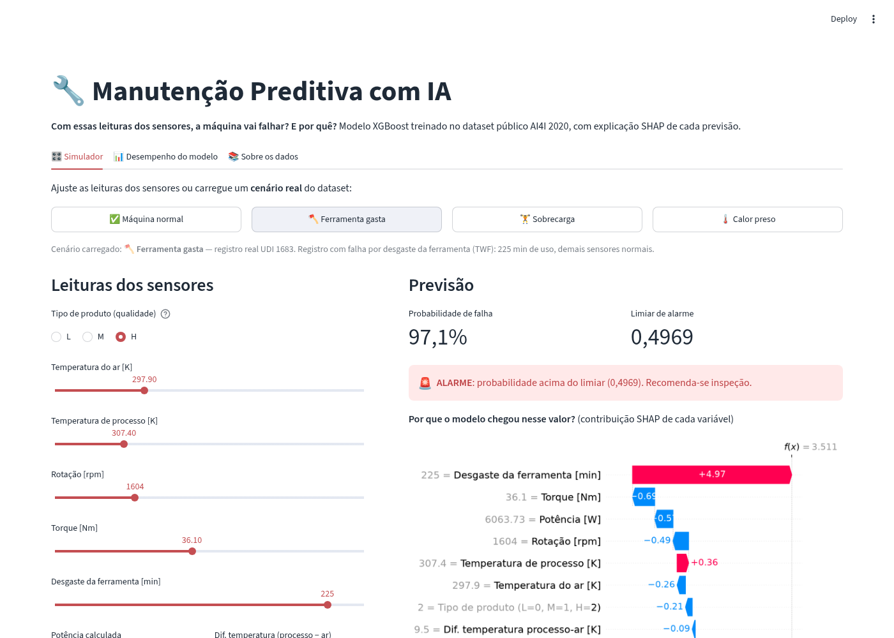
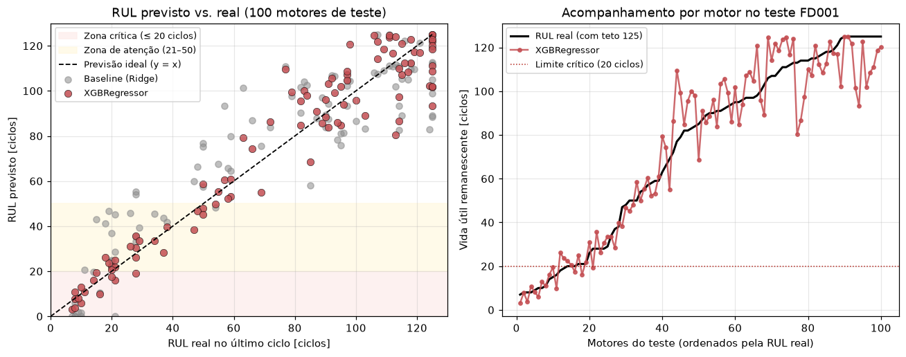
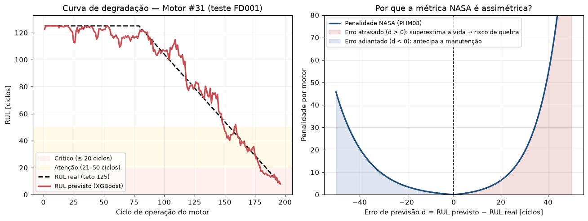
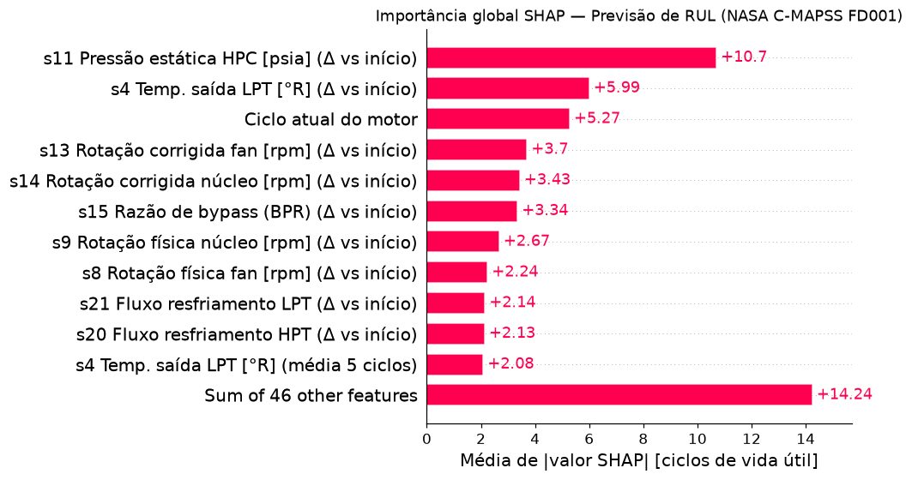
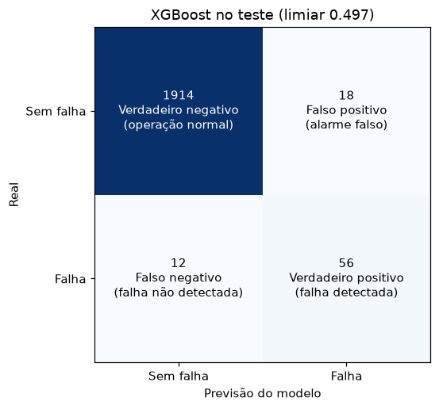
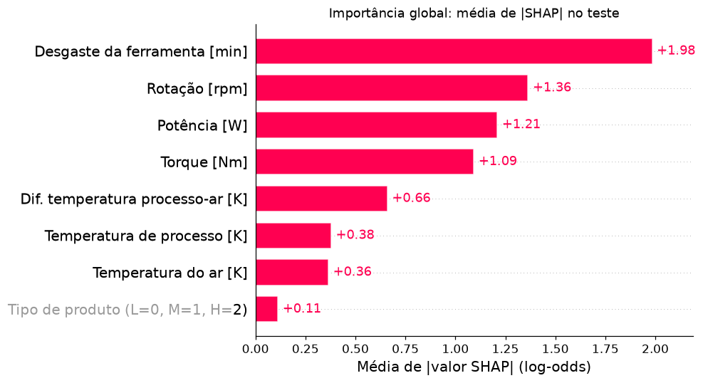

# 🔧 Manutenção Preditiva com IA


[](https://github.com/DenisPaulo/manutencao-preditiva-ia/actions/workflows/ci.yml)

> **1. Com essas leituras dos sensores, a máquina vai falhar? E por quê?** (V1 — Classificação, AI4I 2020)
> **2. Quantos ciclos restam até a falha?** (V2 — Vida Útil Remanescente / RUL, NASA C-MAPSS FD001)
> Modelos com explicação SHAP de cada previsão, construídos por quem vem da manutenção industrial (robôs ABB, CLP e manutenção preventiva).

🔗 **Demo:** [abrir o painel no Streamlit Cloud](https://manutencao-preditiva-ia-3xvamtyr7vvjvcxdbsdnze.streamlit.app/)

[](https://manutencao-preditiva-ia-3xvamtyr7vvjvcxdbsdnze.streamlit.app/)

---

## O problema

Em manutenção industrial, parar a máquina tarde demais custa uma quebra inesperada; parar cedo demais desperdiça vida útil do componente e tempo de produção. Este projeto aborda as duas perguntas clássicas da manutenção preditiva:

- **Versão 1 (Classificação de falhas — AI4I 2020):** estima a **probabilidade de falha** num instante e explica quais variáveis físicas puxaram o risco para cima.
- **Versão 2 (Vida Útil Remanescente / RUL — NASA C-MAPSS FD001):** acompanha a degradação ciclo a ciclo para prever **quantos ciclos restam até a falha**, classifica o ativo em zonas de decisão (**Crítico ≤ 20 ciclos**, **Atenção 21–50 ciclos**, **Saudável > 50 ciclos**) e mostra quais sensores derrubaram a vida útil via **SHAP**.

## Os dados

1. **V1 — AI4I 2020 Predictive Maintenance Dataset** (UCI Machine Learning Repository):
   - 10.000 registros de usinagem, com falha em 3,39% deles.
   - Variáveis: tipo de produto (L, M, H), temperatura do ar, temperatura do processo, rotação, torque e desgaste da ferramenta.
2. **V2 — NASA C-MAPSS Turbofan Engine Degradation Simulation (FD001)**:
   - 100 motores de treino (*run-to-failure*, 20.631 ciclos) e 100 motores de teste (13.096 ciclos interrompidos antes da falha + gabarito oficial em `RUL_FD001.txt`).
   - 21 sensores por ciclo; removidos os 7 sensores constantes no FD001 (`s1, s5, s6, s10, s16, s18, s19`) e `op_setting_3`, mantendo os **14 sensores informativos**.
   - Os arquivos brutos não são versionados (`data/raw/` fica no `.gitignore`), mas os modelos treinados e amostras dos motores estão em `models/` para o painel rodar direto na nuvem. Veja [`data/README.md`](data/README.md).

## Como funciona

| Etapa | V1 — Classificação (AI4I 2020) | V2 — Vida Útil Remanescente / RUL (NASA C-MAPSS FD001) |
|---|---|---|
| 1. Preparação | Remove IDs e colunas de modo de falha (`TWF..RNF`); cria **potência** (`torque × rotação`) e **ΔT** (`processo − ar`) (`src/features.py`) | Remove sensores constantes; aplica teto linear em **125 ciclos** (*piecewise RUL*); calcula média móvel, desvio-padrão (5 ciclos) e $\Delta$ frente ao início do motor (`src/cmapss.py`) |
| 2. Modelos | Regressão logística (base) vs. `XGBClassifier` com `scale_pos_weight` (`src/train.py`) | `Ridge` (base linear) vs. `XGBRegressor` em 57 variáveis temporais (`src/cmapss.py`) |
| 3. Avaliação | Recall, precisão, F1, PR-AUC e ponto de corte por máximo F2 *out-of-fold* (`src/evaluate.py`) | **RMSE**, **MAE**, **R²** e **Pontuação Assimétrica da NASA** nos 100 motores de teste (`src/cmapss.py`) |
| 4. Explicação | **SHAP** em log-odds (global e local por leitura) (`src/explain.py`) | **SHAP** direto em **ciclos de vida útil** (global e local no último ciclo do motor) (`src/cmapss.py`) |
| 5. Painel | Aba **V1 — Simulador de falha** com sliders e cenários reais | Aba **V2 — Vida útil / RUL** com curva de degradação ciclo a ciclo, zona de manutenção e waterfall SHAP |

## Resultados

### Versão 2 — Previsão de RUL (NASA C-MAPSS FD001, 100 motores de teste)

| Modelo | RMSE [ciclos] ↓ | MAE [ciclos] ↓ | R² ↑ | NASA Score ↓ |
|---|---|---|---|---|
| Baseline (`Ridge`) | 16,60 | 13,23 | 0,8285 | 445,1 |
| **XGBoost (`XGBRegressor`)** | **11,13** | **8,31** | **0,9228** | **176,8** |

No conjunto de teste oficial (último ciclo de cada um dos 100 motores, com teto em 125 ciclos), o **XGBRegressor** reduz o erro médio absoluto para **8,31 ciclos** e cai mais de 60% na penalidade assimétrica da NASA em relação ao baseline linear.

<p align="center">
  
</p>
<p align="center">
  
  
</p>

### Versão 1 — Classificação de falhas (AI4I 2020, 2.000 registros de teste, 68 falhas)

| Modelo | Recall (falha) | Precisão (falha) | F1 | PR-AUC |
|---|---|---|---|---|
| Regressão logística | 0,765 | 0,308 | 0,439 | 0,469 |
| **XGBoost (`XGBClassifier`)** | **0,824** | **0,757** | **0,789** | **0,884** |

Cada modelo no seu limiar escolhido no treino (XGBoost 0,4969; regressão logística 0,7349). O XGBoost detecta 56 das 68 falhas com 18 alarmes falsos.

<p align="center">
  
  
</p>

**Por que não acurácia na V1?** Um modelo que responde "nunca falha" acerta 96,6% e não pega nenhuma falha. Por isso o foco é em quantas falhas reais o modelo detecta (recall) e quantos alarmes falsos ele gera (precisão).

## Decisões de engenharia

- **Teto linear em 125 ciclos (*piecewise RUL*) na V2:** enquanto a turbina está saudável no início da operação, os sensores permanecem planos; limitar o alvo em 125 ciclos concentra o aprendizado onde a degradação física realmente aparece.
- **Variação em relação ao início do próprio motor ($\Delta$):** cada motor sai de fábrica com um nível inicial ligeiramente diferente de pressão e temperatura; comparar a média móvel de 5 ciclos com os 5 primeiros ciclos do próprio motor destaca o desgaste acumulado (`s11_delta` e `s4_delta` lideram o SHAP).
- **Métrica assimétrica da NASA:** errar para mais (dizer que restam 40 ciclos quando restam 10) causa quebra em operação; errar para menos só antecipa a manutenção preventiva.
- **Variáveis da manutenção industrial na V1:** potência e ΔT vêm da física do processo, e as colunas de modo de falha (`TWF..RNF`) são removidas para evitar vazamento de alvo.
- **Ponto de corte como decisão de manutenção:** detalhes no [model card](models/MODEL_CARD.md).

## Limitações

- Os dados são **simulados** (AI4I 2020 e simulador C-MAPSS da NASA): demonstram o método de ponta a ponta, mas não substituem validação em equipamento real da planta.
- Na V1 (AI4I 2020), cada linha é um instante isolado e 9 das 12 falhas não detectadas no teste são por desgaste da ferramenta (TWF), que ocorre num instante sorteado entre ~200 e 240 min.
- Na V2 (C-MAPSS FD001), há uma única condição operacional (nível do mar) e um único modo de falha (degradação do HPC).

## Como rodar

```bash
git clone https://github.com/DenisPaulo/manutencao-preditiva-ia.git
cd manutencao-preditiva-ia
pip install -r requirements.txt       # só o painel (os modelos V1 e V2 já vêm treinados)
streamlit run app/streamlit_app.py

# para baixar os dados e retreinar V1 e V2:
pip install -r requirements-dev.txt
python -m src.train && python -m src.evaluate && python -m src.explain
python -m src.cmapss
```

## Estrutura

```
├── data/                  # instruções de download (arquivos brutos fora do Git)
├── notebooks/             # exploração e avaliação passo a passo (V1)
├── src/                   # pipelines V1 (data, features, train, evaluate, explain) e V2 (cmapss)
├── app/streamlit_app.py   # painel interativo com abas V1 (AI4I) e V2 (NASA C-MAPSS RUL)
├── models/                # modelos treinados (.json), métricas, amostras e MODEL_CARD.md
├── reports/figures/       # gráficos de avaliação e SHAP (V1 e V2)
├── tests/                 # testes automatizados (V1 e V2)
├── requirements.txt       # dependências do painel
└── requirements-dev.txt   # + notebooks, linter e testes
```

## Fonte e licença

- **V1 (AI4I 2020):** Matzka, S. *Explainable Artificial Intelligence for Predictive Maintenance Applications*, AI4I 2020. Disponível no [UCI ML Repository](https://archive.ics.uci.edu/dataset/601/ai4i+2020+predictive+maintenance+dataset), licença CC BY 4.0.
- **V2 (NASA C-MAPSS):** Saxena, A., Goebel, K., Simon, D., & Eklund, N. *Damage Propagation Modeling for Aircraft Engine Run-to-Failure Simulation*, PHM08, 2008 (NASA Prognostics Data Repository).
- **Código:** [MIT](LICENSE).

---

Feito por [Denis Paulo](https://github.com/DenisPaulo) · da automação industrial para IA & Dados.
